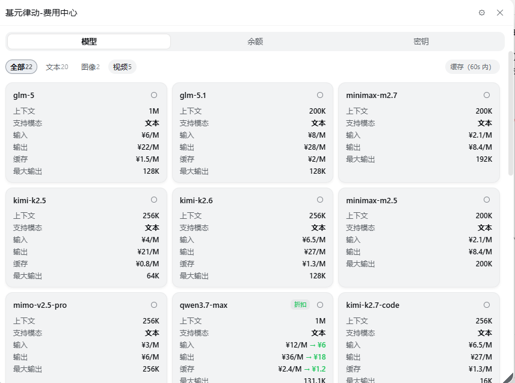
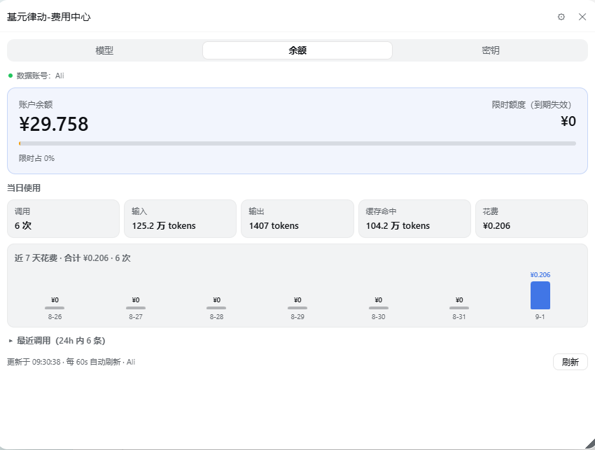
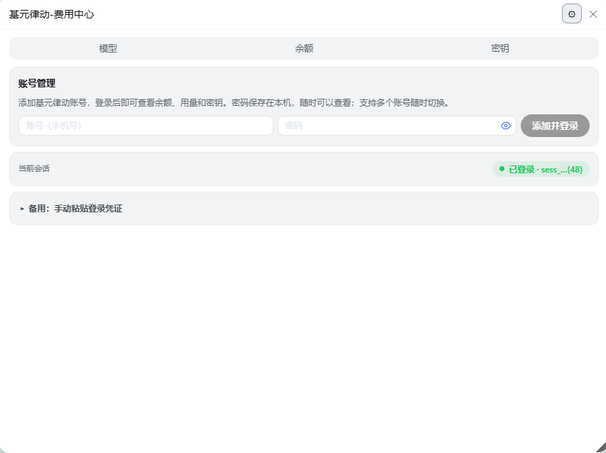
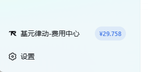

# dsh-tokenrhythm-bill

**基元律动费用中心** —— DeepSeek Harness（DSH）插件，把[基元律动 tokenrhythm.studio](https://tokenrhythm.studio) 的模型清单、账户余额、用量与密钥管理，集中到侧栏底部一个小面板里；另支持阶跃星辰（StepFun）Step Plan、ZCode 桌面端套餐额度、[清枢智汇 tierflow.cn](https://tierflow.cn) 与 [OpenCSG opencsg.com](https://opencsg.com) 的**可选**接入（默认只显示基元，另四家在**设置 → 系统管理**里勾上才出现）。

在 DSH 侧栏底部（设置按钮上方）点击「基元律动-费用中心」入口即可打开可拖拽面板；也可以直接按 **`Ctrl+J`**（macOS `Cmd+J`）呼出/收起。入口左侧是**品牌标 + 名称**，右侧常驻**总余额胶囊**（切号即刷、预警转琥珀色）；**悬停入口**可浮出**限时余额时间线**——逐笔列出每笔限时额度和「N 天后失效」（实时计算，无限时额度时不显示）；侧栏收起时只保留品牌图标。

## 界面预览

> 截图取自 v0.5.2（当时是三页签）。当前版本已扩展为 **余额 / 用量 / 模型 / 状态 / 密钥** 五个页签 + 标题位提供商切换器（基元律动｜阶跃｜ZCode｜清枢｜OpenCSG，**只列已启用的系统**），版式沿用同一套设计令牌，功能以正文为准。

**模型页签** —— 分类筛选 + 卡片网格 + 状态联动



**余额主卡** —— 账户余额 + 限时额度占比



**设置页** —— 账号管理 + Cookie 兜底



**侧栏入口** —— 品牌标 + 常驻总余额 + 预警点



## 功能一览

### 模型
- 顶部**分类筛选**：全部 / 文本 / 图像 / 音频 / 视频 / 向量（带计数，口径与平台模型列表页一致）
- **文本在前、图像在后，价格升序**：图像模型按图片单价、文本模型按输入单价（有折扣取折扣价）；无价格的排组尾，同价内保持平台原序
- 卡片结构对齐平台模型页：**名称 + 状态胶囊**（在线 / 测试中）headline，**模型 ID + 来源**（无问芯穹 / DeepSeek / 百炼…）副行
- **规格 / 价格两栏**：序列长度、支持模态（文本 / 图像 / 视频 / 音频 / 向量）、最大输出长度；输入 / 输出 / 缓存命中单价（折扣时划线标原价，¥x.xx/M）、图片单价
- 折扣模型：标题行最左带**「折扣」徽章**（实底绿渐变 + 白字，行内排布、不影响卡片布局），价格栏同时划线标原价；状态胶囊只显示平台状态（在线 = 绿点 / 测试中 = 琥珀点）——模型页签已无探测联动，探测详情看「状态」页签

### 余额
- **账户余额主卡**：大字展示总余额（带千分位），右侧**限时额度** + **倒计时胶囊**（≤3 天转警示色）+ **限时占比条**（一眼看出多少是「会过期的钱」），有冻结金额时一并显示
- **占比条是两段色（v0.5.22 定稿）**：**主题蓝＝非限时额度**（余额里不会过期的那部分，条子的左段/底色），**橙＝限时额度**（会到期失效的那部分，**落在最右端**，`justify-content:flex-end` 推过去）。原先轨道是灰底、橙段在左，只看得出「限时占多少」；现在两段各自有语义、且限时贴着右端。限时额度恰为 0 时不画橙段（填充段带 2px 最小宽，留着会在纯蓝条右端挂一颗橙色小点）。橙色在本插件里**专属「限时额度」这一语义**：ZCode 页那张占比条走中性配方（灰轨道 + 主题蓝填充），不出现橙色
- **限时占比行右端是「兑换码」入口（v0.6.2 新增）**：那一行**两端对齐**——左边是事实分组（限时占 x% / 冻结），右端一颗品牌色小胶囊「**兑换码**」，点开弹窗输入体验卡兑换码。弹窗与平台网页**同文案、同流程**：说明段用平台原文，点「兑换」先出**独立的确认弹窗**（另起一层遮罩压在主弹窗上，照平台网页的确认框：标题「确认兑换体验卡」+ 平台原文正文 + **取消 / 确认兑换**，没有 ✕、点遮罩不关，Esc = 取消），确认后才提交；成功后弹窗内显示「**已到账 ¥50.00**」（平台金额口径：¥ + 2 位小数 + ceil 进位）与「额度有效期至 YYYY-MM-DD」（平台没给或解析不出就整句不显示），并立即刷新余额主卡与资金明细。失败**原样显示平台原话**（如「体验卡无效、已过期或次数已用完」），不概括、不编校验结论（平台没有「先校验再兑换」的接口）；兑换中输入框与按钮禁用、**兑换中不可关窗**（请求在飞，关掉就看不到结果）
- **当日使用**：调用次数、输入 / 输出 / 缓存 tokens 与命中率、当日花费（本地 0 点起统计）
- **资金明细（v0.5.8 新增）**：把账户余额拆回来源逐笔列出——充值本金置顶，之后每笔赠送额度一行，含**赠送多少 / 已用多少 / 还剩多少 / 何时到期**，按到期早晚排序（临期的排最前）；已用完的（`USED_UP`）也保留，否则就说不清「这一路总共赠送过多少」。摘要行另给「累计赠送」「未到期」两个数
- 每 60 秒自动刷新；临期或余额不足时顶部有预警条
- **页首是一行（v0.5.27 定稿）**：左边「● 数据账号：Ali」，右边「更新于 21:37:58」+ 刷新按钮，**同一行**、两端对齐。原来「数据账号」自己占一行、页脚另有一行「更新于 … · 每 60s 自动刷新 · 账号」——刷新间隔是实现细节、账号名重复，两者现在合成一行，时间从页脚挪到右上角。基元余额 / ZCode 用量两个页签共用同一个 `pageTopBar` + `acctLine`（ZCode 那页左侧文案是「ZCode 账号：…」）。**时刻一律 24 小时制**（自建 `fmtClock`/`fmtClockDay`）：浏览器本地化的时刻格式化会把 12 小时制随系统区域漏出来，英文区域下实测显示「9:37:58 PM」
- **数据账号行挂实名徽章（v0.6.2 新增）**：「● 数据账号：Ali」右边紧跟实名状态——**已实名**（绿）/**审核中**（琥珀）/**未通过**与**未实名**（中性灰，未通过原因写进 tooltip）；认不出的状态透传平台原文（「实名: 原文」+ tooltip 标注平台返回值），绝不硬编。平台**实名门禁**（`apiAccess=blocked`——未实名会被平台 403 暂停 API 调用）时徽章转**警示**并在 tooltip 说明；未实名且在迁移宽限期内，tooltip 追加「宽限期至 YYYY-M-D（还剩 N 天）」。数据来自 `/api/me/identity-verification`（随余额每 60s 刷新，host 按 cookie 缓存 5 分钟、失败回陈旧值；开面板首帧从 manifest 兜底）；**会话数据不可用时徽章不渲染**，只标当前会话账号——ZCode 页保持两参调用不带徽章
- 主卡上方同一行标注**数据归属账号**（显示平台用户名，数据按账号隔离，切换账号立即刷新）
- **侧栏入口常驻余额**：不打开面板也能在侧栏底部看到当前账号余额，切换账号随之更新；**悬停入口**浮出限时余额时间线（逐笔列出每笔限时额度和「N 天后失效」，无限时额度时不显示）；设置页可把胶囊切换为**总余额 / 限时总余额**二选一
- 更长周期（30 天）的用量看「用量」页签；本页不重复放 7 日柱状图与「最近调用」——那两块每次刷新都要翻几十页 call-logs，平台约每 3 个请求就 503 一次（阶跃账号卡展开区那组 7 日 Credit 柱条走的是阶跃自己的接口，与本页无关）

### 用量（v0.5.5 新增，0.5.6 / 0.5.8 优化）
- **近 30 天主卡**：左边**总花费**（主值），右边**调用次数 + 总 Tokens 并排**（都是「用了多少」的量级口径，放一起才好对照）；下方 4 张指标卡做细化拆分：成功 / 失败、中止、输入 / 输出、缓存命中率
- **30 天热力日历**：一格一天，格子底色随当日花费深浅变化（越贵越浓），金额直接摆在格子里；周末列表头与空格另有区分。**标题行右上角有覆盖度角标**（`N / 30 天有调用 · 明细起 XXXX-XX-XX`）——空格子占多数是常态，角标说清「空的是真空」而不是「没加载出来」。悬停**有调用**的格子才浮出当日明细（模型列表 + 各自金额 / 调用数、开源节省）——当天无调用的格子没有可看的东西，不弹浮层。浮层靠左/右边缘的格子自动贴边、第一行的翻到下方，不会被面板裁掉
- **按模型 / 客户端拆分**：**左右并排各占一半宽度**（信息量相当、也常要对照着看，上下排会把面板撑到要滚两屏），各取花费前 6 名排行，带占比条
- **口径说明写死在界面上**：日历只统计最近 30 天；平台没返回明细的日子画虚线框 + 「—」；两个上游接口的 30 天合计若出现分差会显式提示「以汇总为准」，不悄悄选一个
- 每 90 秒自动刷新，可手动刷新

### 状态（自定义检测，v0.5.7 起）
- 官方状态站 2026-09-14 起停更，原先基于它的「服务总览横幅 / 厂商分组折叠面板 / 24h·7d·90d 可用率视图」整块移除；状态页改为**用你自己的 Key 实测**
- **自定义检测卡**：勾选要检测的 **chat 类模型**（图像 / 音频等本就不可探测，直接不列出），点「立即检测」对每个选中模型发一次**真实 1-token 推理**（约 ¥0.0004/模型，计入你的 API Key 账单）；也可选**定时间隔**（5 / 10 / 15 / 30 / 60 分钟）自动重测——**只在面板打开期间跑，关面板即停**
- **结果逐行给出**：状态点（正常 / 降级 / 失败）+ 模型名 + 首字延迟；**没测过的显示「未检测」**，不伪装成正常；失败原因挂在行内 tooltip，完整错误不占版面
- 与模型页签的分工：模型卡上的胶囊只表示**平台标注**的在线 / 测试中；「此刻我的 Key 能不能打通这个模型」看这一页

### 密钥
- 查看平台 API Key 列表（只显示掩码），匹配到本机完整密钥时可一键复制完整值
- 直接新建平台 API Key
- 阶跃首页「密钥」页签里维护阶跃控制台的「接口密钥」：新建 / 复制完整值 / 删除（立即失效）；完整值只在创建时展示一次，列表只显示掩码，复制走本机 host 按需单取，不经过任何服务器
- **切换 DSH 实际在用的 key（「设为使用」）**：密钥页每张卡的动作行有「设为使用」按钮（两段式确认，点了先变「确认切换」再点才动手），当前在用的那张卡顶挂「**使用中**」徽标（判定 = key-plan 反查出的在用 keyId + 归属账号与本行同一条），并且**整卡高亮**（描边取 `--mb-acc` 主色实值、底色 8% 混色，全令牌派生）；平台 `isDefault` 的「默认」标签被用户点名删除——连数据字段都不再读，「使用中」是卡上唯一的身份标记。按下后 host 用该账号会话现场 `ListAccessKeys` 取回完整值，**替换 `~/.dsh/.credentials.yaml` 里 `STEP_API_KEY` 那一行**——宿主凭据 provider 的分层是**文件 > 继承 env**（官方注释 "The managed store wins"）且 watch 变更后 100ms 热重载、引用按请求解析，所以**无需重启，下一句对话就走新 key**。写入是行级手术：与读取端同款正则只动目标行，保留缩进/引号之外的字节（`refs` 流式映射的行尾逗号、`records` 块、注释一概不碰）；分不清就不写（同名 0 行 NO_REF、多行 AMBIGUOUS），含非常规字符 UNSAFE_VALUE 拒写以免写坏 YAML；落盘走 tmp(0600)→rename 原子替换，写完**回读校验**（新值取回 + 行数一致），不过立即**回滚原内容**——不留磁盘备份，避免第二份明文凭据。成功后清空 key→账号反查缓存并让面板**立刻 force 重取 key-plan**：头部角标当场跟着新 key 走，不等 5 分钟轮询。完整 key 只在本机进程内从平台取、直接落宿主自己的凭据文件，**绝不进任何响应体**（界面与日志里连它路过都不许）。附带修正：key-plan / 预付费兜底取 key 从插件早年的 env-first `resolveKey` 改成与宿主一致的 `activeCredentialKey`（file > env）——env 与文件并存时旧口径会让角标描述一把**根本没在用**的 key

### 阶跃（StepFun）
- **提供商切换**：面板标题右侧的 `基元律动 | 阶跃 | ZCode | 清枢 | OpenCSG` 切换器切到阶跃。**切换器只列已启用的系统**（设置 → 系统管理里勾了哪几家就出现哪几段；默认只有基元，所以默认看不到切换器——一个段没有意义）；阶跃那一段还要已配账号才会在设置里出现对应的阶跃分组
- **卡面配色（v0.5.20 修正）**：账号卡改用与模型卡同一套 **浅灰 soft 卡面** + 细描边 + 抬升投影，卡内「账户余额 / Credit 月池」两格**反相为白**。此前卡面用的是 layer-1 实底白，而面板底层是 layer-2（也是白）——同色之下整张卡只剩一根 4% 描边，用户直接反馈「没有颜色、看不出卡片边界」。未查询的 `.dim` 卡仍是虚线框 + 透明卡面，其两格回落 soft，保持原来的观感；**「显示中」那一态保持原样式不动**（用户指定）：accent 8% 叠在白卡面上 + 格面 soft + 左侧 3px accent 竖条
- **「账户」页签（v0.5.9 起账号 + 用量二合一）**：把设置里配的**全部阶跃账号**各列一张卡，每张卡带该账号的**账户余额**与**Credit 月池**（百分比 + 内嵌进度条，档位走 52px 水印、到期与用量在 Credit 格次级行），**Credit 格右上角另挂「↻ M/D 重置」**——月池什么时候刷新剩余额度，悬停看完整时间与剩余天数。卡顶行从左到右是**头像 · 用户名（昵称）+ 实名徽章 · 登录手机号 · 密码胶囊 · 显示 · 删除**（v0.6.1 定稿的顺序）；密码胶囊挪到「显示」按钮前：默认打码（固定 6 个圆点，连长度都不透露），点一下才显明文，同一时刻只展开一个；没有保存密码的旧账号显示「未存密码」且不可点。每张卡可单独**查询此账号 / 展开明细**，卡上可直接**删除账号**（两段式确认）；账号**增删都在这一页**，设置页只留一个跳转入口——列表和增删同一屏，不再两处维护
- **「波峰波谷计价」标识（平台 plan-subscribe 同款）**：平台 Step Plan 订阅页会在订阅状态旁挂一枚琥珀 tag「波峰波谷计价」——它的渲染条件是 `billing_mode === PEAK_VALLEY`（平台前端产物里 `_?.billingMode===V.Yx.PEAK_VALLEY`，枚举 `step.openapi.devcenter.StepPlanBillingMode`：1=STANDARD 标准计价 / 2=PEAK_VALLEY 波峰波谷，STANDARD 平台什么都不画）。本插件在账号卡**Credit 月池的百分比同一排、贴右缘**（与上方「↻ M/D 重置」右缘对齐成一列）画同一枚 tag，判据取 host 侧 `GetStepPlanStatus` 响应**顶层**的 `billing_mode`（**实测坐实**：用户的 Mini 订阅回 `2`，键是 snake_case、无 camelCase 孪生键；枚举回的是**数字**不是枚举名，字符串形态也认，认不出/缺失一律 null → **不画**，不猜计价模式）。含义按平台同一页 FAQ「分时段差异计费」原文写进 tooltip：**高峰时段（北京时间周一至周五，不含中国法定节假日）9:00-12:00、14:00-18:00** 调用 **Step-5-Preview** 时 credits 消耗速率 **×2**，其余时段（午休、晚间、周末、法定节假日全天）为空闲时段、速率不变；tooltip 尾部按本机时间折成北京时间给出「现在：高峰/空闲（北京时间 周X HH:MM）」，并**明写「法定节假日插件不判，请以平台为准」**——插件没有节假日表，宁可声明不判也不冒充判得准。位置不放 Credit 格首行：无头 Chrome 实测 400px 窄格下首行三件（标签 + tag + 重置胶囊）会把「Credit 月池」标签挤成省略号（标签被压到 45.6px→「Cred…」），而标签是理解这一格的锚、重置胶囊是既有信息，两者都不该让位；放百分比行后加 tag 的卡片高度与不加**逐像素一致**（107px，360/400/660 三档均不裁切，tag 为 76×17 琥珀胶囊 `--mb-warnTx` + 12% warn 底——平台原色是 #ad6800/#fffbe6，本插件琥珀只表「与时段/到期有关」的语义，故走 token 不抄字面色）
- **头像 / 用户名（昵称）/ 实名状态（v0.6.1 新增）**：账号卡左上角是**头像**——查到资料且平台给了头像时显示平台图（走宿主代理 `/stepfun/avatar` 取字节，不跨域直连 CDN，带桌面 UA 与防盗链头；加载失败自动隐藏破图、回落字母兜底），没查到资料或没有头像用**昵称首字母**兜底（连资料都没探明时显示「阶」字）。**用户名（昵称）是主显示名**，实名徽章紧跟其后，**只有两种状态**（v0.6.2 收敛，颜色与基元徽章一致）：**已实名**（绿，平台返回码 2）/**未实名**（中性灰）——返回码 1（审核中）也显示「未实名」、语义写进 tooltip；认不出的返回码显示「状态 N」——绝不硬编。资料来自 devcenter `Dashboard/UserInfo` 探测（缓存 15 分钟，与套餐/余额同批刷新）；**没查到资料时头像/昵称/实名三项都不渲染**，一次失败的探测也不顶掉已有资料
- **登录手机号在密码胶囊前（v0.6.1 调整）**：查到昵称后，登录身份（掩码手机号/邮箱）从名字行挪到卡顶行、紧贴密码胶囊左侧——名字行收成一行（用户名 + 实名徽章），整卡矮一行；**没查到资料时它仍是唯一显示名**，回名字行顶主位，不留空卡
- **「显示」= 纯显示偏好**：让侧栏胶囊、主卡和「接口密钥」页都跟着换成这个账号的数据。各账号会话分槽并存，**不切换登录身份、不清缓存、不触发重登**。**页签标签直接带账号**（`密钥（138****0001）`）——增删密钥不可逆，归属不该藏在二级页面里，切了「显示」不进页签就知道这堆密钥是谁的；账号还没探明时退回纯「密钥」，页签文本统一次 `nowrap` + 省略号防长账号名撑爆两格布局。密钥页顶部原来还有一行归属标签（「「xxx」的密钥」+ 跟随说明），已按用户要求整块删除——归属信息由**页签标签**承担，不必在同一屏写两遍
- **会话按账号分槽**（键 = username 小写）：`stepRpc` 省略 username 时按 `pickStepAccount` 的口径兜底到活跃账号，所以 `stepGetSess` 的省略态也必须兜底到 `activeAccount`——多账号重构时这里漏了，而四个密钥 `stepRpc` 又恰好都没传 username，于是 `ListAccessKeys` 稳定报「无可用会话」（已修）。现在四个密钥调用（列表 / 取完整值 / 创建 / 删除）全都显式带 username，测试对每处调用逐一断言。**显式传了 username 却没会话时不许兜底到活跃账号**——那正是「查 B 回了 A 的结果」这类张冠李戴 bug 的温床
- **重置时间的取值与兜底**：优先 `subscriptionResetAt`（订阅月池总表），缺失时降级到 `type=1` 桶的 `nextResetAt`。这个字段**没有实测过**（schema 注释标称秒级、与 `expired_at` 同口径），所以加了合理性窗口 `[今天-1年, 今天+3年]`——窗口外一律不显示，**宁可不显示，也不显示一个公元 5 万年的错日期**。剩余天数走**日历日口径**（0=今天、1=明天、负=已过），与限时额度到期天数一致；不用 `ceil`，否则「今晚就重置」会被算成「还剩 1 天」
- **密码不进列表响应**：账号清单只回 `pwMask` 掩码，明文走独立路由 **按需单取**（只认账号池内的 username，池外 404）——和密钥「列表只回掩码、完整值按需单取」是同一口径。删除账号时会顺手收掉已展开的明文
- **主动作收敛成一个「查询余额」**，放在页签右上角：它才对全部账号真发请求（会话失效的会先自动续期/登录，然后并发拉取），是这一页最重的动作。底部不再放「刷新」——那个按钮只是读 host 本地缓存、零网络，点下去数字不会变；它该做的事 60 秒自动轮询已经在干，且和卡片脚行真查单账号的「刷新」同名不同义，纯属误导
- **三种卡片状态一眼可辨**：**显示中**（主色描边 + 淡主色底 + 左侧竖条）、**已查询**（常规卡）、**未查询**（虚线框 + 无底色 + 「未查询」角标）。不再用整体压暗表示未查询——那会把卡上的删除按钮压得像禁用的，且一屏卡片里看不出差别
- **「显示」按钮是显示偏好，不是切换登录**：点它只把侧栏胶囊与主卡的数据源换成这个账号。各账号会话分槽并存，换显示目标不清任何人的缓存、不触发重登
- **明细默认折叠**：点「展开 ▼」才显示该账号的**近 7 日 Credit 消耗柱条**（最早一条仍在 7×24h 内才敢叫「近 7 日」，否则如实标「最近 7 个有记录日」并说明无调用的日子平台不留痕，不冒充）。柱条排在「展开/收起」按钮**下面**——按钮是这张卡的收尾操作，明细是被它展开的内容，阅读顺序该是先看到开关、再看到展开出来的东西。没查过的账号不显示展开按钮，只给「查询此账号」
- **套餐档位水印**：卡片上压一档 52px 的档位水印（`Mini` / `Plus` / `Pro` / `Max`，四档四色：蓝 / 青 / 紫 / 琥珀，透明度 12%），档位信息只在这一处出现。**认不出的档位一律不画**——画个错档位比不画糟得多。垂直位置写死 `top:44px` 而非百分比：卡片一展开明细就长高，相对整卡定位的水印会跟着跑（实测「一点击展开，水印的位置就变了」）
- **Credit 副行两端对齐（v0.6.1 调整）**：左「`12月20日 到期`」右「`已用 8561.7 万 · 共 4 亿`」同一行、两端对齐（用量 `margin-left:auto` 恒贴右端，到期缺位时也不漂）——原先「已用/共」放在卡片级图例行、与到期分行，同一格的数据要左右两处对着看。档位仍由水印表达，套餐名与自动续费状态不占版面；到期与用量都可能单独缺（平台没给对应字段）：缺一边只渲染另一边，两边都没有时整行不渲染，不留空占位。图例行只剩**加油包**（剩余额度 + 到期，没有加油包整行不渲染）
- **打开面板即自动查全部账号**：各账号会话**独立保存**（落盘），登过一次就长期复用。平台用户 token 寿命 30 分钟（2026-09-24 实测 `accessToken.duration` = 1800s，cookie token 与 JSON token 的 JWT `exp` 均为 30 分钟），但**过期后不用重新输密码**：`PassportService/RefreshToken` 能用旧 cookie（`Oasis-Token` + `Oasis-Webid`）换回本人的新会话——实测过期 1 分钟的 token 打 RefreshToken 返 200、`mode=2`、身份指纹一致、新 token 打 RPC 直接 200。临期前 5 分钟主动续，一路用不到 401。稳态下打开面板：已有凭据的账号**零请求**，只有一条凭据都没有的账号才需要首次登录；会话齐了之后**并发**查询全部账号，不用逐个等。底部有 `N / M` 进度，撞平台软频控会自动中止并说明卡在哪个账号
- **续期有身份核对（防串号）**：平台对「签名非法的 token」只会铸出设备匿名令牌（`oasis_id` 不同、RPC 401）。所以续期拿到新 token 后必须比对 `oasis_id|organization_id`，对不上就整条会话丢掉并落回密码重登——绝不让 A 的设备令牌顶替 B 的会话
- **切号不再清别人的会话**：各账号数据与凭据各自独立，切走再切回仍是本地缓存命中，不必重新登录
- **未查过的账号显示「—」而不是 ¥0**：「查到了 0」和「没查过」是两件事，界面不许含糊
- **侧栏入口胶囊**：阶跃模式下可显示 Credit 月池剩余 % 或账户余额（设置里二选一），悬停仍浮出基元的限时余额时间线
- **对话头部角标（v0.7.1）**：**当前对话在用阶跃模型时**，一枚**套餐剩余进度条**出现在**「对话 / 轨迹」页签同一行的右端**（用户定稿位置：「放在下面，和对话轨迹两端对齐」；页签居左、角标钉右端）。形态：`昵称 ▓Mini▓ 56.8%`——账号位显示**账户昵称**（UserInfo `nickname`，手机号与密钥（连掩码、连打码形态）**一概不上界面**，没昵称显示「未命名账户」），进度条上叠**套餐档位水印**（档位文字半透明压在条面上），剩余不足 20% 条转琥珀（与入口琥珀点同一套告警语言）；**不写「阶跃」二字**——能出现就说明正在用。讲的是 **DSH 里 id=step 那个 provider 正在用的那把 API Key**（`STEP_API_KEY`）所归属账号的 Credit 月池剩余——不是面板的「当前显示账号」，两者可能不是同一个账号，所以口径必须按 key 走。**鼠标悬停出自绘详情卡**（用户定稿「鼠标放上去 展示详细的信息」；不用原生 title——排不了版还撞双 tooltip）：逐行「当前对话 → **使用密钥（只上名字**——用户点名加回「用的是哪把 key」；掩码值依旧不上屏，提取区出现 `.masked` 即红测试**）**→ Credit 剩余/总量（「万/亿」人类口径：2.27 亿 / 4 亿；「已用」行后被用户点名删除）→ 月池重置 → **套餐档位（计费并入同一行、标签只留「套餐档位」**——两段曾在同标签里写全，用户点名精简；值 `Mini / 峰谷计费` 自解释，缺任一段退回单标签原行）→ 数据更新于」——**旧「密钥」行（名字+掩码）、账号、自动续费、有效期四行被用户点名砍掉；此后仅按新口径加回过密钥**名字**一行**：卡只讲这个套餐的数，不放任何辨识信息（打码函数随之整个删除——不存在的东西才是最稳的隐私口径），**拿不到的字段整行不出现**；月池重置沿用面板胶囊的合理性窗口口径（疑似毫秒错值宁可不显示）。**落点实现**：页签行是宿主普通 div（`role=tablist`，带稳定锚点属性 `[data-conversation-tabs]`，flex 布局），owner 端**没有**留插件槽，`conversation.view` 槽注册会多出第三个视图、`conversation.session.header.corner` 是 single 槽且被 DSH 右栏按钮占住——所以角标用 **portal** 直接挂进那一行（官方把 chip 挂进编辑器的同一手法），注册留在 `conversation.session.header.utilities` 当**无头锚点**（session 作用域：切会话自动重挂、工具组里不留任何 DOM）。`react-dom` 是**软引**（try/catch）：插件环境缺它只失去角标，绝不把余额面板拖死（0.7.1「打不开」事故的教训写成了机械测试）。**门控口径**：会话当前模型走这个槽的**标准 prop** `useProjection`——读 `modelSelection` 投影的对外形状 `{ lastUsed, next }`（`next = pending ?? lastUsed`，即当前生效的 provider/model），`next.provider` 不是阶跃 provider 就**整枚不渲染**（用户定稿：「当前对话不是使用的阶跃模型就不显示整个的」——不是显示成 `—`，是根本不出）。**零额外服务依赖**：不引 `modelDirectories`（`directoryFor` 会懒建目录，是渲染期副作用），模型一换角标跟着重渲染、随选随现随隐。判定用 host 回带的 `providerId` 为准，拿不到时退回内置的 `step`/`stepfun` 名单（用户给 provider 改名不该让角标消失）。未启用阶跃 / 数据未到 / 空白投影（从没选过模型）/ 页签行没渲染（开发者工具关着单视图无行）同样整枚不出。5 分钟随预警轮询刷新，**面板关着也更新**。取数口径：key 是**平台访问密钥**、只能查预付费余额（`GET /v1/accounts`），查不到 Step Plan 套餐（套餐 RPC 只认控制台会话），所以 host 侧拿这把 key 去账号池里逐个账号 `ListAccessKeys` 比对**完整 key 值**找出归属账号，再用那个账号的会话取套餐、顺带取其昵称（profile 走 15 分钟缓存，且只把 `nickname` 一个字段带进 key-plan 响应，uid/头像/手机号一概不出门）；匹配结果按「掩码+长度」指纹缓存 10 分钟（列密钥对没会话的账号还要先登录一次，是这条链路上最贵的一步）。**对不上就显示 `—` 并降透明度**、悬停说明原因，绝不拿别的账号的套餐顶上；拿不到总量读数时**不画条也不画水印**（一根空轨道会被读成「剩 0%」）

### ZCode（默认关闭）
- **总开关**：读本机 ZCode 凭证的能力**默认关闭**——设置弹窗「**系统管理**」组里勾上「ZCode」后，面板标题切换器才会出现「ZCode」这一段，插件后台才被允许访问 `~/.zcode/v2`（host 侧路由同样有门禁，双重保险）；取消勾选即停读，面板恢复原样（阶跃、清枢智汇也在这个组里，同一套开关口径）
- **用量页签**：读取本机 ZCode 桌面端登录凭证（默认 `~/.zcode/v2`，**跟随数据目录设置**，兼容改过 `dataBaseDir` 的用户），直连官方接口查询当前套餐——档位 / 到期 / 剩余额度百分比 / 已用占比 / 分项限额；BigModel 通道优先，自动回退 z.ai 余额接口，兼容个人订阅与活动赠送多套餐切片。每 60 秒自动刷新
- **入口胶囊**：切到 ZCode 时侧栏胶囊同步换成 ZCode 身份（闪电图标 + 套餐剩余百分比），无数据时自动回落基元余额
- 凭证解密与请求头伪装逻辑移植自开源工具 [zcode-switch](https://github.com/pjpv/zcode-switch)（MIT），并用其跨语言测试向量对拍锁定
- **安全与风险**：ZCode 凭证只在插件后台内存与本机文件中出现，浏览器只见掩码；相关接口为官方未公开接口、请求头伪装成桌面端，存在被平台风控的可能，请自行斟酌使用

### 清枢智汇（TierFlow，默认关闭，v0.7.0 新增）
- **总开关**：设置弹窗「系统管理」组里勾上「清枢智汇」后，切换器才出现「清枢」这一段、面板才出现**账户 / 套餐用量**两个页签（末尾那个页签的标签带当前显示的账号——「套餐用量（X）」，与阶跃的「密钥（账号）」同一放法，用户定稿「看看阶跃密钥 tab 后面是什么，你也怎么放」；超长由 `.dsh-mb-tab` 的省略号兜，没配账号时不留空括号。原先这行账号在「套餐用量」页签自己的页首行里，只在那一页看得见，而「面板在看哪个账号」是全局信息）；host 侧每条 `/tierflow/*` 路由同样有门禁——系统关着时**一律不发上游请求、也不产生登录尝试**（浏览器控制台直接打路由也一样）。**设置里有一个「清枢」分组**（勾上才出现，组名与切换器分段名一致），里面只放一张**「胶囊接管（清枢智汇）」**卡——胶囊口径四选一（**总余额 / 限时余额 / 套餐余额 / 套餐 token**，见下面「入口胶囊」），没有别的可选项要摆；账号的增删仍在面板「账户」页签里做，不搬进设置
- **账户页签**（对齐平台 [tierflow.cn/usage](https://tierflow.cn/usage)，布局照阶跃「账户」页签的走——用户定稿「账户的两个部分合二为一」）：**没有页首行也没有单独的主卡**——原先「清枢智汇账号：X · 更新于 · 刷新」的页首行和一张只讲当前账号的主卡都删了，因为主卡讲的就是当前账号，而当前账号本来就是下面账号卡里的一张，同一份数据在两处出现只是重复。现在**每个账号一律一张卡**（`dsh-mb-stepacc` 骨架与阶跃**一比一**，用户定稿「显示的布局以及 7 天的消耗保持一致」）：顶行**全部放在一行**（用户定稿「放在一行」；阶跃那张卡把密码胶囊压在名字行下面，清枢一屏可能好几张卡，压成一行省一层高度），且**左右分工**（用户定稿「账号密码放在右边」）：**左边只回答「这是谁」**——头像 + **身份层级**（显示名取平台用户名，与阶跃用昵称当显示名同理；没查到用户信息时退回登录身份本身，不编「—」——这是「账户信息的布局也对齐」那一条）+ **「未查询」徽章**（会话态徽章「已登录 / 待登录」按定稿**整枚删除**：清枢的会话由插件按存的密码自动续期，「本地有会话」是常态，常态不值得每次喊一声，真缺会话也只是「下次查询会自动登一次」这种会自愈的过渡态；名字行只留这枚**待办**角标）；**右边**（`.dsh-mb-stepacc-tail`，整簇 `flex:none`，不参与压缩）**回答「能对它做什么」**——**登录身份灰字**（当初填的手机号 / 邮箱，只在与显示名不是同一字符串时才出）+ 密码胶囊（只在本机读，单取路由）+ 显示控制 + 删除，视线扫右边缘就能找到动作。显示控制在当前账号是**「当前显示」徽章**（`.dsh-mb-stepacc-cur`：主色实边小胶囊，与「未查询」那枚虚线灰胶囊一眼分得开；它顶掉了原先那枚禁用的「显示中」按钮——一行里同一句话不写两遍，省下的宽度还给显示名），其余账号是可点的「显示」按钮；宽度不够时**只有名字缩**（`min-width:0` + 省略号），右侧簇不缩（它们是理解这张卡的锚）；**一行两格数据格**（阶跃同款 k/v/sub 配方）：左**账户余额**（次级行「累计已用 ¥X」）｜右**全部到期合计宽格**（定稿「这个换成。限时余额 以及 不限时的余额」+「右边放全部到期合计，就是余额」——原先这一格讲「当前套餐」，现在讲**钱包的构成**；套餐额度与订阅明细仍在「套餐用量」页签，账号卡不再重复第二遍）：右上角「MM-DD 到期」chip（最近一笔到期日）、**全部到期合计（限时余额）**为主体数值、**两段余额条 + 占比图例（卡片级两行，不再嵌在右格里）**（定稿「账户卡片的进度条 参考基元的展示格式」——这两行照基元余额主卡的「统计 → 条 → 图例」顺序落：条**铺满整张卡**（原先嵌在右格只有半张卡宽，而它讲的是**整份余额**里有多少会到期，读的对象是两格之和），蓝底 = 不限时在左、右端橙段 = 限时在右，轨道 `.dsh-mb-hero-bar.limited` + 填充段 `.dsh-mb-hero-bar-fill`，填充段自身无圆角、被轨道的 `overflow:hidden` 裁成**齐平**一段；原先借的是阶跃那条**单段**进度条的 `.bar.limited>i`，填充段带 6px 圆角，橙段会读成「右端挂了一颗橙点」），橙色在本插件里只此一义）、紧跟条下面的图例行（`.dsh-mb-hero-legend` + `.dsh-mb-legend-bits`）**两端对齐**：左端写「限时占 N%」，右端挂这张卡自己的「**购买订阅**」品牌色胶囊（定稿「购买订阅 和 限时占 73% 部分 两端对齐」＋「购买订阅 按钮 添加 颜色」——与订阅卡「升级套餐」、基元「兑换码」共用同一份 `.dsh-mb-hero-btn` 配方：主色字 + 12% 浅底 + 42% 描边，像素值只写在样式表一处）。这一行**只要这张卡在就渲染**：条与占比都可以因为「没查过 / 无限量 / 平台没给到期额度」不出，但右端挂的是这张卡唯一的付费入口，不能随数据状态时有时无（条的那个 `if` 只管条，别把图例行一起塞进去）。右格次级行只留「限时余额 · N 笔」。左格因此从「账户余额」改成「**不限时余额**」（定稿「左边放不限时的，就是总的减去右边的」），总额与累计已用退到它的两行次级——**左格 + 右格 = 总额**，两格就是钱包的全貌。**口径**：全部到期合计 = **会到期失效**的那部分——平台给的是**到期计划** `gift_expiring_schedule`（逐笔 `{quota, at}`），`gift_expiring_quota` / `gift_expiring_at` 只是其中最近一笔，host 侧按平台「赠送到期计划」下方那行**合计到期**的口径把**还没到期**的各笔加起来（已过期的笔不计：平台已经回收，算进去就是虚增；再按 `quota` 夹一次上界，绝不出现「限时 > 总额」；计划为空而 `gift_expiring_quota > 0` 时退回那一笔兜底）；不限时 = `quota − 全部到期合计`、永不过期，两个数都按 `quota_per_unit` 折 ¥。**脚行**（阶跃同款）：「展开 ▼ / 收起 ▲」（没查过的账号这里是「查询此账号」）+ **数据时间**（该账号余额 / 套餐两个快照里较新的取数时刻，host 新增 `userAt` / `subAt`——没有它，缓存里的旧数看着就像新数）+「刷新」（真打平台，从顶行挪过来，与阶跃同位）——**「购买订阅」不在这一行**（见上条：它在那条图例行的右端；脚行本来就挤着展开 / 查询、数据时间、刷新，再塞一枚付费入口进去，四样平铺谁也看不出层级）。**展开后的明细块**＝**近 7 日 token 消耗逐日柱条**，与阶跃「近 7 日 Credit 消耗」同画法（同 `.dsh-mb-step-bar`：日期 + 轨道 + 数值）：host 在 `tfFetchUsage` 里按**本机日历日**分桶（新增纯函数 `tfUsageDayBuckets`，平台 `/api/data/self` 一次可能回上千行原始行——一行一次调用，原样下发既费带宽又没意义，面板要的只是「哪天多少」这七个数），条长按窗口内最大值归一，标题「近 7 日 token 消耗」；**只画最近 7 个有记录日**（定稿「token 消耗 只显示 最近有消耗的 7天」——平台不记无调用的日子，「有记录日」即「有消耗的日子」；更早的桶切掉，原先全画时标题才被迫写出桶数），最早记录超过 7×24h 就改写成「最近 N 个有记录日」，**绝不冒充**；单独那句「最早记录 M-D · 无调用的日子平台不留痕」**按定稿删除**（标题已把口径说清，不必再挂一行灰字）；**合计那行挪到了脚行、紧跟在「收起」后面**（定稿：`.dsh-mb-stepacc-sum`，「近 7 天合计：N 次请求 · X token · ¥Y」，口径同平台 `/usage` 顶部）——明细块首从此只有标题 + 每天的条，而合计跟在开关旁边读得通两遍：收起时它是「收起来的是什么」，展开时它是「展开这一坨一共多少」；宽度不够时它自己省略（脚行右侧的「数据时间 + 刷新」是常驻动作，不能被一行合计挤掉），全文始终在 tooltip 里。每张卡显示的是**它自己**的快照（host 侧账号清单纯读内存、零网络），要更新哪张点它自己的「刷新」、一次刷全部点「查询全部」；当前账号靠 `.cur`（accent 描边 + 左侧竖条 + 顶行右端的「当前显示」徽章）区分，没查过的卡走 `.dim`（虚线框 + 透明底 + 数值降灰）。**「用户角色」不显示**（定稿删除：平台给的是角色码 0/1/5/10/20/100 → 访客 / 用户 / 经销商 / 管理员 / 高级管理员 / 超级管理员，绝大多数账号就是「用户」两个字，占一格大字不值当；host 侧仍照常归一化 `roleName`，只是面板不显示）；「注册于」也随主卡一起下架（卡里暂时没有它的位置，要保留说一声就加回某格的次级行）。平台那排静态档案（用户名 / 邮箱 / 手机号 / 赠送额度 / 限时赠送 / 累计请求 / 用户 ID / 登录密码）**一概不渲染**——字段照常取回、账号管理照常工作，只是面板不再铺。**金额一律按 `quota_per_unit` 折算**（平台默认 50 万 quota = ¥1，取不到就用这个默认值——绝不显示成 ¥0）；`quota < 0` 显示「**无限量**」而**不过金额格式**（否则会渲染成 `-¥0.0000`）。卡尾原先那行安全说明（「登录凭证（会话 cookie）只留在本机状态文件 · 接口经插件后台代理，浏览器只见掩码 · 『显示』只决定面板看哪个账号，不影响其他账号的会话」）**按定稿整条删除**——三件事都是插件的实现口径，不是这张卡要让用户做的决定，删掉后卡片列表直接结束、不再拖一条灰字尾巴（这些口径本身照旧，见下面「多账号」与「会话与安全」两节）。**删除按钮样式**：它既当图标用也当文字按钮用（阶跃侧是一个 `✕`，清枢侧是「删除」两个字），原先写死 `width:22px` 而两个汉字约 24px、横向溢出盒子——看着就是「删除」两字没有边界；改成 `min-width` + 自适应宽 + `box-sizing:border-box`：`✕` 仍是 22×22 的方框（与改前逐像素一致），文字则随字数长出内边距。字号统一到 meta（待删态的「确认」本来就是 meta，图标比它大一号没有道理）；悬停铺一层 12% 的淡警示底而不是只换字色（删除是破坏性动作，红色应当是**可点的面积**，淡底走 `color-mix` 与主题同源，暗色下不会糊成一块脏红）；忙碌（正在删 / 正在查）时去掉悬停反馈并降到 55% 透明度；待删态仍是实警示底 + 白字（`.armed`）
- **套餐用量页签**（对齐平台 [tierflow.cn/billing/subscription](https://tierflow.cn/billing/subscription)）：**页首行左边是「全部订阅（N）」、右边是「更新于 …」+ 刷新，同一行两端对齐**（清枢不往页首行挂动作：右上角那个「升级订阅」总入口已按定稿删除，升级的入口只在订阅卡上）（定稿；正文里原先另起的那行同名标题随之删掉——同一句话说两遍，第二遍只会把首屏顶下去。外层 `.dsh-mb-topbar` 是 `justify-content:flex-end`，标题靠 `margin-right:auto` 顶到最左，自身那份给块级标题用的 `margin-top` 清零）；**没有独立的「当前套餐」卡**（定稿删除——主卡内容本来就是从这份列表里挑出来的，单独再渲染一遍等于同一份套餐说两遍），全部订阅（含生效中的那份）**逐条按主卡样式渲染**：标题行左边是套餐名（平台已下架则为「已下架套餐」）+ 状态 · 来源（**来源里「等于没说」的三个不写**——`order`=购买 是默认路径、`upgrade`=升级 与卡底「由「X」升级而来」是同一件事、`subscription`=订阅 是同义反复，用户定稿「购买的那个占位删除」＋「专业版生效中 下面的 升级 也删除」；赠送 / 兑换 / 试用 / 管理员发放照写，认不出的来源也照写），右边**第一行是「剩余天数 + N 天」并排**（定稿「剩余天数 30 天 放在一行显示」——标签与数字挨着读成一句），第二行是**期限两个端点并在同一行**（`生效 2026-10-04 · 2026-11-03 到期`；缺一端就只显示存在的那端，两端都缺整行不出），下面**两条进度条**（**剩余套餐额度** / **剩余 Token 池**）；两行的**余量都占主数位**——20px/600 **主色** + 等宽数字（字号与卡右上「剩余天数 N 天」同一档，颜色与正下方那条额度条的填充同色：条画的就是这个余量的占比），「/ 总额」退成 11px 灰字的次量（定稿「全部订阅（2）的剩下的余额 突出显现」＋「token 的余量 也是 添加的颜色」；两段并排走 `.dsh-mb-stat-line`，类名 `.dsh-mb-legend-v` / `.dsh-mb-legend-sub`），卡底一行给「下次重置 / 是否已绑密钥」（两样都没有就不出这行），有升级来源的再补一行「由『X』升级而来」。**生效中的那份另加标识与高亮**：标题旁一枚绿徽章「生效中」（副行不再重复这三个字，只留来源），卡面走 `.dsh-mb-hero.is-active`——描边 25% → 55%、底色 7% → 12%，左侧补一条实心蓝轨（整框加粗在两张卡挨着时看不出哪张更重，左轨是有方向的，一眼分得开）。判定与 host 挑当前套餐同一口径：`status === 'active'` 且未过期（`end_time` 缺失视为不过期），时刻取**取数时刻** `atMs` 而不是 `Date.now()`——数据可能是 5 分钟内的缓存，拿当下时间比会在到期临界点上闪一下。**数值一律「剩余 / 总额」**（用户定稿）：条画的是**剩余**百分比，值原先给「已用 / 总额」，条和数各说各话——条剩 34% 而数写 78.7 / 119.9，一眼分不清说的是用了还是剩了。平台**没有 remaining 字段**，剩余就是 `总量 − 已用` 客户端算（`amount_total − amount_used`、`basic_token_total − basic_token_used`），与进度条同源；剩余为 0 是「用完了」，照实显示 0（`tfTokensOf` 把 0 当「平台没给」显示「—」，剩余不能复用它）。**实付金额不显示**：面板管用量不管账单。**两套单位绝不互相换算**：`amount_*` 是 quota 整数（折 ¥，`≤0` = 无限量），`basic_token_*` 是**原始 token 计数**（`-1` = 无限量、`0` 显示「—」、其余按 亿/万 缩写）；订阅列表里**过期照实列出、已取消的不列**（用户定稿「排除已取消的套餐」，两种拼写 cancelled / canceled 都认），顺序**最先订阅的在前面**（用户定稿）——平台给的是它自己的顺序，host 侧 `tfNormalizeSubscriptions` 按 `start_time` 升序重排，缺 `start_time` 的排最后；页首「全部订阅（N）」的 N 就是排完之后的条数
- **升级订阅弹窗（只用余额升级）**（定稿「升级订阅直接弹窗。参考 https://tierflow.cn/billing/subscription 套餐详情列表 的 升级」＋「升级订阅应该是对应套餐升级的」＋「查看官方源码的升级套餐原理，我们只用余额升级即可，不使用微信和支付宝」）：点订阅卡右端的「升级套餐」不再把人甩去浏览器，而是**在面板里开一层弹窗**（与设置 / 兑换码同款 `.dsh-mb-modal`：点遮罩 / ✕ / Esc 关闭；挂在面板根上、不跟正文滚动）。套餐用量页**每张生效中、且目录里还有更高档的订阅卡右端**挂一个「升级套餐」胶囊（定稿「升级的按钮 添加到 每个套餐里面」＋「旗舰版 的 就不要显示 升级按钮了」：已在最高档的不出按钮，点了弹窗里那一组也是空的），与卡片页脚那行「下次重置 / 已绑密钥」两端对齐、共用「兑换码」入口那份胶囊配方（样式表里只写一处像素值）；点它开的还是这层弹窗，但**只看那一份订阅**——弹窗标题行变成「只看「轻享版」这一份订阅」，旁边多一个「看全部订阅（N）」列出其余可升的订阅；那一份要是不在「可升」里（目录比卡片缓存新），自动退回可升清单，不给一个空弹窗。右上角原来那个「升级订阅」总入口已按定稿删除。已过期的订阅卡不出这个按钮（升级是生效中订阅的动作，过期该走续费）。判据来自 `/tierflow/plans` 里同 `subNo` 那组的 target 数（>0 才出），所以打开套餐用量页时会顺带取一次套餐目录（host 侧 5 分钟缓存，不进 60s 轮询）；目录还没取到时默认不出按钮。订阅卡上**不摆订阅号**（定稿「订阅 SB1261014774051。这个删除」）——要认号就 hover 升级弹窗里的组标题。已在最高档、或档位在目录里查不到的订阅**整组都不列**（定稿「把『没有可升档位』的组也从弹窗里去掉，只列真能升的」）；全都在最高档时弹窗只留一句「都在最高档，没有可升级的档位。」。弹窗**按订阅分组**——一组 = 一个生效中的订阅（= 一个套餐），组标题就是这一档套餐本身（套餐名 + 「生效中」徽章 + 右端「剩余 N 天 · 额度 ¥X」，订阅号进 tooltip；组标题与组内第一张卡之间再压一条 8px 下边距，连同组内 gap 合计 16px，标题不再贴着卡片——定稿「专业版 / 生效中 / 剩余 30 天 · 额度 ¥59.9  添加下边距」），组里只列**比它贵**的档（升级是某个订阅的套餐升级，平台把这动作挂在每一条订阅上，原话「仅支持升级到更高价格的套餐」）；弹窗标题行只剩「看全部订阅（N）」（收窄视图里才有），连它都没有时整行不出——「刷新」与说明句都按定稿删掉：弹窗是点卡那一刻现开的，页首那一下刷新和升级成功后的自动重取已经够用，而真看到旧差价也不会误扣款（host 下单前会复问一次报价，对不上就不发付款请求）。每张目标卡三行（定稿「样式优化。删除废话」）：卡头左起套餐名 + 平台的「推荐」/「已停售」标记，右端「¥59.9 / 30 天」（`price_amount` 是**钱**，直接就是元；期限由 `duration_value` + `duration_unit` 归一成「30 天」）；第二行只摆事实「额度 ¥119.9 · Token 池 3000 万」——平台那段副标题宣传语删掉；第三行左边是**升级差价**（橙色，全插件「与到期 / 限时有关」的那个色，tooltip 摊开平台的算法；平台不肯升时这个位置改放平台的原话），右边是这一档的主动作「**余额升级**」（实底按钮）——钱和动作挨着，不用上下找。
  **升级只用余额**（定稿），链路与官方源码 `zf.js` 里的封装一一对应：`v` = `GET /api/subscription/upgrade/quote?sub_no&plan_slug`（平台算差价，**面板不自己相减**）→ `Yr` = `POST /api/subscription/upgrade/balance`，body `{sub_no, plan_slug}`（从**账户余额**扣款并升级）；官方那个 `KZ`/`kO`（`/api/subscription/upgrade/wechat` + `/wechat/pay`）**不接、不实现**——要微信 / 支付宝付款时，面板里**连一个「去平台付款 ↗」的外链都不留**（本插件只做余额这一条，要用别的付款方式就自己开平台的订阅页；密钥页那两枚「官网管理 ↗」与本条无关）。请求体是**探出来的**而不是猜的：拿「往更便宜的档升」的请求打过去，平台在扣费之前就被价格守卫拦下（原话「仅支持升级到更高价格的套餐」），说明字段名就是 `sub_no` + `plan_slug`；不存在的订阅号回「订阅不存在」、空 body 回「参数错误」——三条都不动账。
  **真花钱的动作，面板比用户更谨慎**（两道自保，都在 host 侧 `fetchTfUpgrade` 里）：① 先自己现问一次报价，报价失败（平台拒绝 / 查不到差价）就直接回错、**根本不发付款请求**；② 客户端把它展示过、并被用户点过确认的差价原样带上来（`expectedDue`），与现问的对不上就**不扣款**，回 `TF_UPGRADE_PRICE_CHANGED` 连新报价一起带回来，由用户对着新价再确认一次。客户端是**两步**：点「余额升级」先弹确认框（`.dsh-mb-modal.confirm`，z-index 40 盖在弹窗上；写明「哪一档 → 哪一档」、差价、以及「当前余额 ¥1,180.19 → 升级后约 ¥1,150.19」，并说明不走微信 / 支付宝、不经过面板的任何中间户头），确认后才 `POST /dsh-tokenrhythm-bill/tierflow/upgrade`；成功后清掉该账号的三份缓存（余额 / 订阅 / 套餐）并自动刷新，失败则把**平台的原话**红字摆在确认框里。升级成功后余额与订阅即刻变化，平台的合同与到期日按平台规则重算。
  **续费不在面板里做，购买挪到了账号卡上**（原先这里写的是「购买 / 续费都不做」，已被新定稿「账户 的 部分 添加 购买订阅 的功能 只能 余额 买」取代，入口位置随后又按「不应该是账户的，不要放在最上面」挪到了每张账号卡（先落在卡片脚行，后按「购买订阅 和 限时占 73% 部分 两端对齐 / 购买订阅 按钮 添加 颜色」定格在卡里「限时占 x%」那条**图例行的右端**）——买在账户页那层弹窗，见下面那条）：没有可升的订阅时弹窗只留一句状态，不列套餐目录、也没有任何「去平台购买」入口；过期的订阅同样不谈升级（已取消的连列表都不进）。数据走 host 路由 `GET /dsh-tokenrhythm-bill/tierflow/plans`（与 user / subscription 同套：5 分钟缓存、`force=1` 穿透、失败退回上次成功的数据、换账号清缓存；响应里还带一份余额快照给确认框用，命中 user 缓存时零网络），归一化是纯函数 `tfNormalizePlans` / `tfNormalizeQuote` / `tfDurationLabel` / `tfHigherPlans`（`[]` = 已在最高档、`null` = 这档不在目录里，两者含义不同）。
- **购买订阅弹窗（只能用余额购买）**（定稿「账户 的 部分 添加 购买订阅 的功能 只能 余额 买」）：升级是「把已有的一份换到更贵的档」（付差价，入口在订阅卡上），**购买是「新开一份订阅」**（付整价），所以入口挂在**每张账号卡「限时占 x%」那条图例行的右端**上（定稿「不应该是账户的，不要放在最上面」＝顶部那条「添加账号 / 查询全部」栏里没有它；位置随后又按「购买订阅 和 限时占 73% 部分 两端对齐」定在这条读数行的右端——左端是占比这个事实，右端是这张卡唯一能花钱的动作，两端对齐），**不再与「展开 / 查询此账号」「数据时间 + 刷新」并列在脚行里**（原先那版是脚行左侧的次级 ghost 样式，四样动作平铺、灰描边，看不出层级；现在改用品牌色胶囊 `.dsh-mb-hero-btn`——定稿「购买订阅 按钮 添加 颜色」）——**点哪张卡就是买哪个账号的余额**；一张账号卡都没有时也就没有入口（不摆一枚点不动的）；**已有生效订阅照样能再买一份**（用户定稿「照样能买新的一份」）——平台这个动作本来就是新开一份，买不买得了由平台的限购说了算。点开是与升级弹窗同款的模态层，**弹窗里不写说明行**（用户定稿：把「用 X 的余额支付（当前余额 ¥Y · 快照）」与「这里是新开一份订阅（付整价）」两句**都删了**）——付款账号就是点进来那张卡（`forId`：目录按它的 `identifier` 单独取一份、下单时也带着它），「新开一份 vs 换档升级」由两个入口名与二次确认框里的措辞区分，同一个意思不在弹窗里讲第二遍；账号卡上那枚「购买订阅」按钮同样**不带悬浮 title**（按钮文字自己就是名字，这次一起删掉）。配了多个账号时，**弹窗里的目录是按点进来那张卡的账号单独取的一份**（请求带 `identifier=`，与页面上「当前显示」那份目录**分开存**——给别的账号买一次，不会把这个账号的余额 / 订阅算进去），所以弹窗里**没有账号切换那一行**：要换账号就换一张卡点进来；而**付款账号在点「余额购买」那一刻就随这份目录锁定**（待确认记录里带着 identifier），之后再切「显示」也不会把钱扣到别的账号头上）。**只列真能买的档**：平台标了隐藏的、没给价的、价 0 的都不列（这条链路要的就是「付多少钱」，没有金额就没有可确认的东西），一个都没有时写「平台现在没有可买的套餐档位」；「已停售」的档照旧列出来，但不留按钮。**「只能余额」是硬闸**：平台不让这一档用余额付（`allow_balance_pay === false`）时按钮当场禁用、原因写在档上和 tooltip 里；微信 / 支付宝那条（`/api/subscription/wechat/pay`）**不接、不实现**，面板里也没有别的付款入口（要别的付款方式自己去平台网页）。**余额够不够只当提示**（档上写「余额可能不够（快照 ¥X）」但按钮照旧能点）：面板手上的余额是**快照**，拿它硬拦会在快照旧时挡住正当购买，够不够由平台判（原话「余额不足」原样透传）。**限购只当事实**（「平台限购 N 份/人」写进 tooltip，绝不写「已达上限」——平台没把已购份数给面板，认不出来就不编）。**两道确认**：点「余额购买」先弹确认框（与升级同款 `.dsh-mb-modal.confirm`，写明档位 / 期限 / **¥整价** 与「当前余额 ¥X → 买后约 ¥Y」，并说明「确认后立即从账户余额扣款，不走微信 / 支付宝」），确认后才 `POST /dsh-tokenrhythm-bill/tierflow/purchase`；成功后余额与订阅自动刷新（host 会清掉该账号的三份缓存），并把平台回签的**订阅号**写进成功文案——平台会为这份订阅**签发专用密钥**，去平台「密钥」页取。host 侧 `fetchTfPurchase` **三道自保**（新购**没有报价接口**，现读的目录就是价签）：① 目录里查不到这档 / 已停售 → 不发付款请求；② `allow_balance_pay === false` → 不发付款请求；③ 客户端展示过、被用户点过确认的价格原样带上来（`expectedPrice`），与现读的对不上（平台调价）就**不扣款**，回 `TF_PURCHASE_PRICE_CHANGED` 带上新价让用户重确认。请求体只有 `{plan_slug}`（官方源码 `zf.js` 里 `Ax` 同款，**不带** `sub_no`——那是升级的体）。
- **多账号（同阶跃口径）**：账号池在 host 侧，密码只落本机状态文件（浏览器只见固定 6 个圆点的掩码，明文走「点击眼睛」的单取路由）。每张账号卡可单独**显示 / 查询此账号 / 购买订阅 / 删除**（购买 = 用这张卡的账号余额新开一份订阅；删除是两段式确认）；「显示」只换面板看谁的数——**不切登录身份、不清别的账号的会话**，「查询全部」会逐个补齐（缺会话的先登录，账号之间串行并让开 30 秒冷却）。加账号时**先真登一次**：密码错、账号开了两步验证这类**确定性失败当场拒收**（不保存），只有网络抖动这种暂时态才先存下、等冷却解除自动补登录
- **会话与安全**：平台登录成功只下发一枚 `session` HttpOnly Cookie（前端不存 token），插件按账号分槽存在本机状态文件（`0600`）、重启 DSH 复用；被平台作废（401）时自动用保存的密码重登一次。登录尝试有 **30 秒冷却**——连点是账号被封最短的路径。**两步验证账号暂不支持**（会明确提示，不假装登录成功）。凭据只在 host 进程内存与本机文件里出现，面板关着或切到别的系统即停止轮询
- **入口胶囊（口径四选一）**：切到清枢智汇时侧栏胶囊同步换成清枢身份（饼图图标）。显示哪个数由**设置 → 清枢 → 「胶囊接管（清枢智汇）」**四选一，选中值落 host prefs 的 `entryTfMode`（认不出的值不落库，客户端回落「总余额」= 这一组出现之前的行为）：**总余额**（默认，账户余额折 ¥）／**限时余额**（`gift` 里会到期的那部分 ÷ 单价，`0` 是有效读数、照实显示 ¥0）／**套餐余额**（当前生效套餐的剩余额度 `amount_total − amount_used`）／**套餐 token**（当前生效套餐的剩余 token 池 `basic_token_total − basic_token_used`，按 亿/万 缩写；token 与金额是两套单位，绝不互相换算）。改口径当场重算并回写 host；**面板关着也有数**——那轮 5 分钟的常驻轮询会在「当前显示的是清枢」时一并刷新胶囊值，另一窗口改的口径也随它跟上来。**拿不到数据时不显示数字，也绝不回落基元余额**（宁缺不假）：未登录 / 查询失败 / 没有生效套餐 / 平台没给 token 池（`basic_token_total === 0`）都落成空胶囊；平台标了不限量就写「无限量」（不走减法，免得拿 0 当余额）

### OpenCSG（默认关闭，v0.7.0 新增）
- **总开关**：设置弹窗「系统管理」组里勾上「OpenCSG」后，切换器才出现「OpenCSG」这一段、面板才出现**账户 / 用量 / API Key**三个页签（末尾那两段的标签带当前显示的账号，与阶跃「密钥（账号）」同一放法）；host 侧每条 `/opencsg/*` 路由同样有门禁——系统关着时**一律不发上游请求、也不产生登录尝试**。设置里有一个「OpenCSG」分组，里面只放一张**「胶囊接管（OpenCSG）」**卡（口径三选一），账号的增删仍在面板「账户」页签里做
- **登录方式只有账号 + 密码一种**：坐标是 Casdoor IAM（`iam.opencsg.com`），不是 opencsg.com 自己的表单——门户的 `/login` 只是 Casdoor 的半成品代理；平台里 `csghub` 这个应用**不存在**，实测可用的是 `CSGShip`。**组织名是要发对的**：Casdoor 拿请求里的 `organization` 原样去查人（`auth.go` 的 `CheckUserPassword` → `GetUserByFields`，每个字段都按 organization 过滤），发错组织就等于查无此人；而它对「这个组织里没这个人」和「密码错」回的是**同一句话**（防枚举），从报文上分不出来。所以插件把坐实的主组织 `OpenCSG` 放第一、`built-in` 兜底逐个试——用户的账号在一个确定的组织里，而发错组织时 `signinWrongTimes` 计在 User 记录上、根本不会 +1，所以兜底既不会误判也不会锁账号。凭据只存本机 host 的状态文件，浏览器只见掩码；面板里唯一能看到明文的是「密码胶囊」，且只走一条单取路由
- **令牌是「本地 JWT」，不是平台 access token**：csghub-server 用 Casdoor 会话换出来的本地 JWT，claims 只有 `uuid / current_user / iss / exp / iat`。实测能用的鉴权头是 `Authorization: Bearer <本地 JWT>`；**只带 cookie 不行**（401 `AUTH-ERR-1`），`Authorization: OAuth <本地 JWT>` 也不行（401 `AUTH-ERR-5`——那一支只认 Casdoor 的 access token）。加账号时会**先真登一次**再保存：密码错、账号名不对这类问题当场拒绝保存并显示平台原话；登录尝试有 30 秒冷却
- **账户页签（布局照清枢智汇）**：一个账号一张卡，卡面两格 = **账户余额**（`GET /api/v1/accounting/credit/{uuid}/balance` 的 `balance`，**单位是分**——门户源码里就是 `e.data.balance / 100`；次级行摊开构成 `composition.cash` / `.bonus`）+ **待发放余额**（邀请口 `GET /api/v1/invitations` 的 `pending_credit`；次级行给「已邀请 N 人 · 累计 ¥x」）。**「API 调用量」按用户定稿从卡面退场**（余额与用量各归各页：钱在这页、调用量在「用量」页签）。卡脚那行「数据时间」**常驻**：没查过的账号写「数据时间 —」（悬浮说明怎么取数），查过的写取数时刻——原先它只在查过之后才出现，「没查过」在界面上就是一片看着像坏掉的空白。单卡「刷新」只重查那一张，不动「当前显示」那一份。**刷新后「数据时间」不许被抹空**（用户点名「数据时间 要实现」坐实的 bug）：`fetchOcAccount` 四条成功路径（缓存命中 / stale×2 / 新查）原先**都没回带取数时刻**，而客户端刷新是 `next.at = r.at`——清单路径有 `at`、刷新路径没有，于是点一次刷新，本来好好显示的数据时间就退回「—」。现在 host 每条成功路径都带 `at`（新查的 `at` 与写入缓存的 ts 同一个值，不打两次表），客户端再加一道闸：`at` 只有是合法正数才覆盖，降级响应宁可保留旧时间也不清空——**两路口径从此一致**。**账号卡按「当前显示」置顶**（用户 2026-10-18 要求）：`ocPinActive` 把正在显示的那张卡提到列表第一张（它本来就带「当前显示」徽标，置顶后第一张自明），其余账号保持本机存的顺序——不做按余额/按名字的二次排序，找得到就提、找不到（activeAccount 为空或对不上）原样返回，不猜不重排。实名状态（`verify_status`）与用户名走 `GET /api/v1/user/{name}`（顺带兜住 uuid）
- **「本期」= 本月 1 号 → 今天**，与门户计费页的日期初值同义（**不是「近 30 天」**）。金额一律分 → ¥；「平台没给」显示「—」，而 `0` 是有效读数（照实显示 ¥0 / 0 条）——两者不混为一谈
- **用量页签（v0.7.1 重排，版式照基元「用量」页）**：两段式 = **汇总 hero → 按接口拆分**，数据同一条口 `GET /api/v1/accounting/credit/{uuid}/bills?…&scene=15`（门户「计费 → API 调用量」用的就是它，`scene=15` = LLM 调用）。
  - **汇总**：主值「本期花费」（信封 `total_value`）+ 右上并排副值「调用」（`total_count`，实测 = 各行 `count` 之和）与「总 Tokens」（`total_consumption`，2026-10-17 实测逐行 = 输入 + 输出）+ 指标格「输入 / 输出 · 推理 · 缓存命中（= 缓存 ÷ 输入）· 窗口」。**「计费记录」条数原先也是一格，用户说「这个不需要」，删了**。窗口合计全是**服务端算好的** `total_*`，与分页无关，缺字段显示「—」。
  - **按接口拆分**：rank 表（接口名 / 份额条 / 花费 / token 合计；调用次数、四路 token、由几条账单合并都在悬浮里）。表头就是「按接口」三个字——**页脚那段口径说明和「前 N / 共 M · 按 X 排」的尾巴按用户要求删了**，只有列表真被截短（接口数 > 12）时才补一句「共 N 个接口，只列出前 N 个」。宿主按 `per=100` **翻页取全量**（2026-10-17 实测 `per=100` 可用、`per=500` 被平台直接拒 400；最多 5 页 = 500 行），同名接口的多行**先聚合再交上来**（协议层 `ocAggregateBillsByApi`）；份额条与排序**同一个口径**（有花费读数按花费排，整表没有才退回按 token），分母 = 本表最大值；跨表再对一道账：逐接口花费合计应与窗口 `|total_value|` 一致，对不上界面明说「以窗口合计为准」（实测逐位相符）。**取不全时界面明写「份额不是整窗口份额」**，不拿部分行冒充整窗口。
  - **花费在同一页对照看**（用户 2026-10-18 改口：「按接口怎么没花费呀」——原先「这一页只出现用量」的定稿作废）：**主位就是「本期花费」**（信封 `total_value`，与基元那张卡把总花费放在最大字号位一致），按接口每行也有该接口的花费（账单行 `value` 合计）；总 Tokens 退到右上副值。**平台把扣费记成负数**，界面按门户同款口径取绝对值显示，原值写在悬浮里（不改账）。余额与赠金仍只在「账户」页，不在这里重复。
  - **日期展示**：窗口区间同年两边都省年份（「10-01 ~ 10-17」，格子标签写着「本月至今」，年份不言自明），跨年才两边写全；完整 ISO 区间与「本月 1 号 → 今天」的口径在悬浮里。认不出的输入原样摆出来，不猜日期。
  - **热力日历不做**：账单口没有按天的口，行里的 `created_at` 只是记录时间（实测有账的账号所有行都落在同一天，无法证明一行是「接口×天」还是「接口×窗口」），拿它铺日历就是编。
- **API Key 页签（v0.7.1 新增，门户 `/settings/api-keys` 同款能力）**：列表 `GET /api/v1/namespaces/{ns}/apikeys`、创建 `POST` 同径、删除 `DELETE /api/v1/namespaces/{ns}/apikeys/{id}`。`ns` = 用户命名空间 uuid（就是本地 JWT 的 `claims.uuid`，**不是用户名**）。三点实测坐实的口径：
  - **列表里的 `token` 是服务端掩码**（实测 `gk***36`），明文**只在创建响应的 `data.token` 里出现一次**（55 字符）。
  - **创建的密钥会在本机留存一份明文**：落 `~/.dsh/tokenrhythm-bill-state.json`（0600，与账号、会话同一文件、同一信任边界）的 `oc.savedKeys`，按账号分槽、每账号上限 50 条。历史列表里那几行因此可以点「复制完整值」按需单取（走 `apikey-reveal`，明文不进列表载荷、不进日志）；不想留的按行「不再在本机保存」（`apikey-forget`），远端删除成功或账号被移除时副本一并清除。**掩码行永不落盘**（协议层认出含 `***` 的值直接判废条目）。
  - `token_type` 列表里是 `builtin|custom`、创建响应里却叫 `owner`；内置 key 不可删（界面据此不摆删除按钮）；无过期时平台回 **Go 零值 `0001-01-01T00:00:00Z`**（解出负毫秒），一律归一成「长期有效」。
- **不接的是「管理员报表」，不是 token**：门户里 `token-report` / `statements` / `price` / `vouchers` / `recharges` 的调用方都是管理员页，普通账号实测**一律 403 `AUTH-ERR-6 需要管理员权限`**，所以这些口一个都不查。逐接口 token 走的是**普通用户自己的账单口**，不是那些管理员口
- **入口胶囊（口径三选一）**：切到 OpenCSG 时侧栏胶囊换成 OpenCSG 身份，显示哪个数由**设置 → OpenCSG → 「胶囊接管（OpenCSG）」**三选一（**账户余额** / **API 调用量** / **待发放余额**），选中值落 host prefs 的 `entryOcMode`（认不出的值不落库，客户端回落「账户余额」；0.7.0 老存档里存的 `vip` / `usage` 也走这条回落）。**拿不到数据时不显示数字，也绝不回落基元余额**
- **安全**：密码与令牌只在本机 host 内存与状态文件里出现，浏览器只见掩码；加账号时的登录与所有查询都由 host 发出，浏览器不直接连 `iam.opencsg.com`

### 快捷键（全局，跨五个提供商）
- **`Ctrl+J` 呼出/收起面板**（macOS 为 `Cmd+J`）：按一下开、再按一下关，不必去点侧栏入口
- 键位走 DSH 官方的快捷键服务，因此会自动列进 **设置 → 快捷键**，搜「费用中心」即可改键，也可以清空改成「仅菜单呼出」——不需要本插件自己再造一套键位配置界面
- 该键在**页面和输入框里都生效**（否则面板开着、焦点在密码框时按不关），但**有模态对话框开着时不动作**——浮层藏在模态后面开合，只会让人以为快捷键失灵
- **这是应用内快捷键，不是全局热键**：DSH 没有把 Electron 的 `globalShortcut` 开放给插件，所以 DSH 窗口不是焦点时按了没反应
- **web 端默认给 `Ctrl+Alt+J`**：浏览器不转发 `Ctrl+J`（那是「下载」），只承认 `primary+alt` / `primary+shift` 这类双修饰组合。若在 web 端也写 `Ctrl+J`，快捷键注册会直接失败，桌面端一并失效
- 快捷键插件被禁用/缺失时，本插件静默没有快捷键，面板与侧栏入口完全不受影响

### 对话输入行的两个图标按钮（v0.5.11 新增，v0.5.13 起为图标方案，v0.5.14 起交互简化，v0.5.16 起失败可见）
- **计划** 与 **压缩** 两个**图标按钮**挂在对话输入行的**模型选择器左边**（DSH 的 `conversation.input.right` 槽位：DOM 上排在模型选择座之前、同处 `.trailing` flex 组，该组无 `row-reverse`）。顺序为**计划在左、压缩在右**（压缩紧邻模型选择器）。图标路径与官方输入行控件同源（16×16 网格），28×28 方形、图标 14px；文案放在 `aria-label` 与 hover 提示里，不占版面
- **输入行一个文字都不出**：两个按钮都成功静默、失败只写进自己按钮的 tooltip（`· 上次失败：…`）。压缩按钮旁原先那条「压缩中…／结果／报错」回显行已整条删除，连自动消失的计时器与对应 CSS 规则一并清掉（不留没人渲染的死规则）
- **失败必须有非文字反馈**：只写 tooltip 的话，一次失败看起来就是「按钮坏了、点了没反应」（实测踩过）。所以失败时对应按钮的**图标转红 6 秒**后自动恢复，原因仍在 tooltip 里——不违反「不出文字」，但绝不会静默
- **对话正在跑时压缩按钮禁用**：判据取会话快照的 `running`（与官方 InputBar 取的是同一个字段）——轮次进行中平台一定拒绝 `/compact`（活动中的压缩／非空闲 agent），不该给一个点了必然失败的按钮。**计划按钮不受这个条件影响**（它只在自己的命令在飞时禁用）
- **压缩** = 执行官方的 `/compact`：把较早的对话历史替换为一条摘要，**不消耗模型轮次**。命令自己的结果仍照常出现在**对话里的命令行**（DSH 渲染 `conversation.chat.commandview`）：没有可压缩历史是 `No compactable history yet.`，轮次占用中是平台侧的固定文案「暂不可用」——**按钮这一侧不再复述这些文字**。**上下文占用超过 60% 时按钮转红**（浅红底 + 红图标 + 红描边），当前百分比也写进 tooltip；口径与官方 ContextMeter 逐字一致：`min(100, round((projectedTokens ?? pressureTokens) / contextWindow * 100))`，拿不到投影时不红
- **计划** = 切换计划模式：未激活时执行 `/plan`；激活后按钮转蓝（accent 高亮的「计划中」态），再点执行 `/plan off` 退出。状态读的是**宿主投影**（`plan` 的 `{active, pending}`，宿主折叠值）而非本地猜测——与官方计划片同一数据源
- **不再显示 `/plan` 在对话里的命令行**：那句「Plan mode on. Use /plan off to leave.」/「Plan mode off.」是命令的返回值文本，DSH 会把命令运行渲染成一行（`conversation.chat.commandview`，按命令名分派）。本插件占住 `plan` 这个键并渲染空，那一行就不再出现。**只藏 `plan`**——`/compact` 的结果（压缩了多少条历史、省了多少 token）是有效信息，照常保留
- **命令桥固定三个业务参数（只面向桌面端 DSH 2.0.x）**：`commands.execute(agentId, line, submittedAttachments)`——第三个是「本次提交的附件」，按钮调用没有附件，所以传 `[]`（之后才是可选的取消信号）。少传会在**发出 RPC 之前**就被客户端网关拦下抛错（实测 `client api: commands/execute expected 3 business argument(s) …, got 2`），表现就是「点了没反应」。本插件不再为更早的两参数契约做兼容：v0.5.18 试过读 typert 描述符自适应实参个数，v0.5.19 起直接写死桌面端契约，少一层会猜错的东西
- **明细字段不并排**：模型卡的规格与价格原本拆成两个 `dl`、各占一栏，现在合成一个单栏 `dl` 逐行列出（用户指定「不要并排」）
- **默认宽度一行 3 张模型卡**：网格轨道下限抽成锁定令牌 `--mb-mc-min-w: 190px`，同时把面板默认宽度从 560 提到 660（`DEFAULT_PANEL_W`，默认几何 / 拖拽兜底 / prefs 兜底四处同源）。列数 = `floor((面板宽 − 34 + 8) ÷ 198)`：面板 660（新默认）与 661 都是 **3 列**（卡宽 ≈203px），拖到 ≥818 才自然变 4 列，<620 回落 2 列、<422 单列；骨架屏网格同下限，加载态不跳列。面板宽度存在 prefs 里，已有安装的实际宽度不受默认值改动影响（老默认 560 仍是 2 列）
- 执行期间两个按钮都禁用，防重复提交；执行期间切了会话则丢弃这次结果，不会串到另一个会话
- **边界**：本槽位在轮次进行中**依然渲染**（DSH 的 `.trailing` 无条件渲染 `rightItems`，只有模型选择座会进入 locked 态），所以「轮次中不可用」这件事必须由按钮自己禁用表达，而不是指望它被隐藏；没挂 `dsh-command-compact` / `dsh-plan-mode` 时，对应按钮不出现（不摆一个必然报错的按钮）；命令桥缺失时连注册都不发生，**面板与余额功能完全不受影响**
- 计划模式激活时官方还会在输入行最左端显示一个「计划」片（那是退出入口），两者并存、互不冲突
- **「模式切换通知」这一条藏不掉**：DSH 在模式真正切换时会写入一条 `notice` 形式的用户消息（「The user switched this session to plan mode.」/「…back to the default mode.」）。本插件**无法只挑计划模式那一类**隐藏——它的 DOM 钩子（`data-context-summary`）被 8 种 notice 共用（模型切换、子代理完成、任务/目标、webhook、工具提醒…），按 DOM 隐藏会把那些有效通知一起干掉；宿主侧也没有开关（`dsh-plan-mode` 的 config 只接受 `section`，未知键直接加载失败）。真要去掉，只能接受「所有 notice 行都不显示」，需要的话说一声

### 设置（面板右上角 ⚙，弹窗打开）
- **系统管理（v0.6.2 新增，v0.7.0 起五家，分组页签第一位）**：**基元律动 / 阶跃 Step Plan / ZCode / 清枢智汇 / OpenCSG** 五个开关，决定哪几家能在面板里出现——**默认只勾基元律动**，另四家**勾上才会出现**（切换器那一段、对应页签、相关卡片一起出现；没勾的连入口都不摆）。**每个开关右侧直接列出这家自己的页签**（基元：余额 / 用量 / 模型 / 状态 / 密钥；阶跃：账户 / 密钥；ZCode：用量；清枢智汇：账户 / 套餐用量；OpenCSG：账户 / 用量 / API Key），一行看清「勾上会多出什么」，不再摆说明段落。**设置分组页签也跟着开关走**：没勾的那家，它那一组设置卡整组消失（基元组＝账号管理 / 备用粘贴 / 入口胶囊余额；阶跃组＝胶囊接管，且要已配账号；清枢智汇组与 OpenCSG 组各只有一张「胶囊接管」卡，账号的增删在面板「账户」页签里做），当前分组被取消时自动落回「系统管理」——不留一组属于已关系统的设置（**收尾口径**：清枢智汇与 OpenCSG 的分组都只有胶囊口径这一张卡，没有第二个可选项要摆）。**至少要留一个**：取消最后一个会被当场拦下并给提示，host 侧同样不接受「五个全关」的存档（老存档只有旧的 ZCode 总开关时按它推导，不会被悄悄关掉）。原来的「ZCode 集成」开关卡已并入本组。勾选**当场落盘**（宿主的 `prefs.systems`，与面板位置同存于本机状态文件），下次开面板、重启 DSH 都还在
- **账号管理**：添加 / 一键切换 / 删除**多个**基元律动账号，密码保存在本机、随时可明文查看
- **当前账号行实名徽章（v0.6.2 新增）**：账号名后带与余额页同款的实名徽章（已实名绿 / 审核中琥珀 / 未实名灰）；基元是**单会话**（一次只有一个网页会话），**其余账号没有各自的会话数据、不渲染徽章**——不编数
- **入口胶囊余额**：侧栏入口胶囊显示「总余额」或「限时总余额」，点击即切换并记住选择
- **插件更新**：自动比对 npm 最新版本（24 小时缓存），有新版时状态转高亮并提供「复制更新命令」，只提醒不自动执行
- **备用粘贴**：网页会话 Cookie（`tr_session`）兜底登录（默认折叠，用的时候展开）
- **阶跃分组只留一项（v0.5.24 定稿）**：「接管时胶囊显示」（自动 / Credit 剩余 / API 余额）。**接管本身是固定行为**，所以原先的「接管 / 不接管」两个按钮整行删除——没有可选项就不必摆开关，历史存档里的 `takeover:false` 也不再采纳（否则老存档会停在「不接管」而界面上再无入口改回来）。同一轮按用户要求删掉的还有：**基元分组的「当前会话」状态卡**（「已登录 · sess_…」，会话由插件自动续期，不需要看）、**「阶跃账号（Step Plan）」说明卡与「去「账户」页签管理账号」按钮**（账号增删本来就在面板「账户」页签，不必再写一张卡把人指过去）——这些卡一并不渲染，连带的 CSS 规则（`.dsh-mb-status-row` / `.dsh-mb-status-pill` / `.dsh-mb-key-owner*`）与死参数同时清掉

## 安装说明

任选以下一种方式安装，**安装后需重启 DSH**，侧栏底部才会出现入口。

**方式一：插件市场**（收录后可用）

在 DSH 插件市场搜索「基元律动费用中心」或 `dsh-tokenrhythm-bill`，一键安装。

**方式二：命令行 · npm 源**（推荐，秒级安装）

```sh
dsh plugin --profile web add dsh-tokenrhythm-bill
```

> 已装过旧版本？重复执行上述命令即可**更新**到最新版，然后重启 DSH。

## 首次配置

1. 点击侧栏底部「基元律动-费用中心」入口 → 右上角 ⚙
2. 添加基元律动**账号和密码**并登录（一次性；密码只保存在本机）
3. 回到「余额 / 用量 / 模型 / 状态 / 密钥」页签即可使用（面板默认落在余额页），入口右侧会常驻显示当前账号总余额

> **平台登录接口不可用时**：浏览器登录 [tokenrhythm.studio](https://tokenrhythm.studio) → F12 → 应用 → Cookie → 复制 `tr_session` 的值，粘贴到「备用：粘贴网页会话 Cookie」框中保存（直接粘贴 `tr_session=sess_…` 整串也认）。Cookie 过期后余额页签会引导你回设置重新登录。

> **会话自动续期**：登录成功后 Cookie 保存在本机并自动复用；粘贴新 Cookie 即完成切换账号（自动识别身份）。会话过期时，若该账号已保存密码则**自动重登同一账号**并继续刚才的操作，全程无感；未保存密码的账号才会提示重新登录。

## 提供商名册从哪来

余额 / 模型 / 密钥页签要知道「哪个 baseURL 是基元律动」，靠的是 DSH 的 LLM 提供商名册（`llm-pi-ai.providers`，`baseURL` 含 `tokenrhythm` 才算余额可用）。这个名册的位置随 DSH 版本变过：

| DSH 版本 | 活存储 | 本插件的读法 |
|---|---|---|
| 0.1.6 及更早 | `~/.dsh/settings.yaml` 的 `llm-pi-ai.providers` 段 | 直接读（flow / block 两种布局都支持） |
| 0.1.7 及以后 | `~/.dsh/profiles/<name>/cordis.patch.yml` 里 `- id: llm-pi-ai` 条目的 `config.providers` | 回退读补丁层 |

> **为什么会有这张表**：0.1.7 起 DSH 把 `settings.yaml` **废除**了——设置服务把它改名成 `settings.yaml.imported`，各段写进当前 profile 的补丁层，此后**原文件不再重建**（重建会造成第二次导入，把 Setup 默认值盖回用户的选择上）。所以升级后 `~/.dsh/settings.yaml` 消失是**正常现象**，不是配置丢了。
>
> 插件按「settings.yaml → 装着本插件的 profile 的补丁层 → 其余 profile 的补丁层 → 家目录级补丁层」的顺序取第一个非空结果，**只读不写**，绝不替你重建 `settings.yaml`。

如果面板提示「未配置基元律动（tokenrhythm）提供商」，说明这两处都没有 `baseURL` 含 `tokenrhythm` 的 `llm-pi-ai` 条目——在 DSH 设置里加一个 baseURL 为 `https://tokenrhythm.studio/v1` 的提供商即可（同一个 profile 的补丁层会自动带上，无需手动编辑文件）。

## 隐私说明

- 账号密码与会话 Cookie 只保存在**本机**，**永不下发浏览器**
- 界面中的 API Key / Cookie 一律显示掩码；完整值仅在你主动点击时才复制到剪贴板

## 常见问题

- **余额页签有几天是虚线空格？** 就是那几天没有调用。30 格里调用数与花费的合计和汇总页签是逐位相同的（实测算术：`/api/usage-daily` 分桶 30 天 = `/api/usage/panel?range=30d` 的 summary），所以空格子是真空，不是页面坏了。日历标题行右上角的角标会写明 `N / 30 天有调用 · 明细起 XXXX-XX-XX`。
- **资金明细里的行怎么还有「剩 ¥0」的？** 那是用完了的额度（`USED_UP`）。留着它是为了说清历史——「累计赠送 ¥184」这个数只有把每一笔赠送都列全才对得上；删掉用完的，账就平不了了。这些行整行压暗，不抢眼。
- **切换账号后数据变成 ¥0？** 余额、用量都按账号隔离——切到没用过的账号自然为空，切回原账号即恢复原数据。
- **阶跃「账户」页签里另几个账号显示「—」？** 那是自动补齐还没跑到它（首次冷启动要依次给缺会话的账号登一次），或撞上了平台软频控被中止——底部会写清卡在哪个账号、还剩哪些。补齐完成后切走再切回仍是本地缓存命中，不必重查。
- **余额显示「会话已过期」？** 到设置页重新登录，或重新粘贴 Cookie。
- **面板提示「settings.yaml 与各 profile 补丁层…」？** 这是 host 侧读提供商名册失败时**透出的真实原因**（0.1.7 起 DSH 已废除 `settings.yaml`，名册改存 profile 补丁层，详见「提供商名册从哪来」）。以前这类失败会被概算成一句「没有提供商」，让人照着去改一个本来没问题的文件；现在 host 说什么就显示什么。名册本身没问题却仍报错，多半是插件版本太旧。
- **`Ctrl+J` 按了面板没反应？** 三步排查：① DSH 窗口是不是当前焦点窗口（应用内快捷键，非全局热键）；② 有没有模态对话框开着（设置等模态打开时按键被刻意忽略）；③ 进 **设置 → 快捷键** 搜「费用中心」，看命令在不在、绑键是否被清空或与别的命令冲突。三者都排除后仍无效，说明快捷键服务没被加载——此时面板与侧栏入口照常可用，只是没有快捷键。
- **设置里勾的系统（基元 / 阶跃 / ZCode / 清枢智汇 / OpenCSG）像是没保存住？** 勾选存在**宿主进程**的 `prefs.systems`（本机状态文件 `~/.dsh/tokenrhythm-bill-state.json`），浏览器里不留副本，所以：**升级插件后必须先重启 DSH**——宿主进程还跑着旧版本时它不认识 `systems` 这个字段，写请求会被静默丢掉；此时面板会当场写明「宿主进程还跑着旧版插件代码，重启 DSH 后再勾选才会保存」，不会假装已保存。重启后勾一次即长期有效（勾选与面板位置同存一处）。
- **清枢智汇账号加不上 / 提示两步验证？** 加账号时会**先真登一次**平台：密码错、账号名不对这类问题会当场拒绝保存并显示平台原话。**开了两步验证（2FA）的账号本插件暂不支持**——平台登录后会要求第二个验证码，插件不接这一步，所以直接提示而不是假装登录成功。登录尝试有 30 秒冷却，连续点「添加 / 查询」不会更快，反而可能触发平台风控。
- **清枢智汇余额为什么是「无限量」？** 平台把不限量额度记为 `quota = -1`，插件照实显示而不去套金额格式（套了会变成 `-¥0.0000`）。同理套餐额度 `≤0` 是无限量、Token 池 `-1` 是无限量、`0` 是「平台没给」显示「—」——三种状态不混为一谈。
- **OpenCSG 为什么没有「套餐 / 档位」？** 用户定稿「不需要套餐」，所以订阅那一层（`/accounting/subscriptions/status` 的档位名、周期、按档位的「已用 / 配额」）**整层退场**——卡面与协议层一起删掉，而不是「留在代码里不显示」：没有消费方的代码就是死代码，留着只会在下次重构时骗人。卡面上现在只有那三个能对上账的读数。
- **OpenCSG「按接口」那几个数是怎么来的？** 宿主把账单行按接口名**聚合**后交上来（同名接口的多行合一，界面不会重复出现同一个模型），每行的数字是平台自己的 `consumption`（= 输入 + 输出，逐行实测相符）与行级 `count`（调用次数）；份额条的分母是**已取回行**的 `consumption` 之和。窗口级合计（总 Tokens / 调用 / 花费）一律只认服务端给的 `total_*`，不与自算的数混用——两套口径同时摆在屏上早晚会对不上。翻页取不全（超过 5 页上限）时界面明写「份额不是整窗口份额」。
- **OpenCSG 某一格显示「—」是什么意思？** 那一项**没读到**（平台没给这个字段，或那条口这次失败）——**不是 0**。`0` 会照实显示 `¥0` / `0 条`。某条口回 403（没权限）时，插件只把那一项降级成「—」，**不会**把整张卡变成错误、更不会误判成「登录失效」去重登：**只有 401 才重登**（401 = 令牌/会话真失效），403 说明令牌已经被认出来了，只是这个口不给权限。这条对本插件尤其要紧——账单口与邀请口**都还没用真实普通账号验过**，万一它们回 403，卡片也必须照旧把能读到的数显示出来。
- **OpenCSG 账号加不上？** 加账号时 host 会**先用账号密码真登一次**（Casdoor IAM），密码错会当场拒绝保存并显示平台原话；平台侧登录尝试有 30 秒冷却。**左手边的「密码胶囊」能看明文**，因为凭据本来就存在本机、且只走一条单取路由；浏览器其余部分一律只见掩码。
